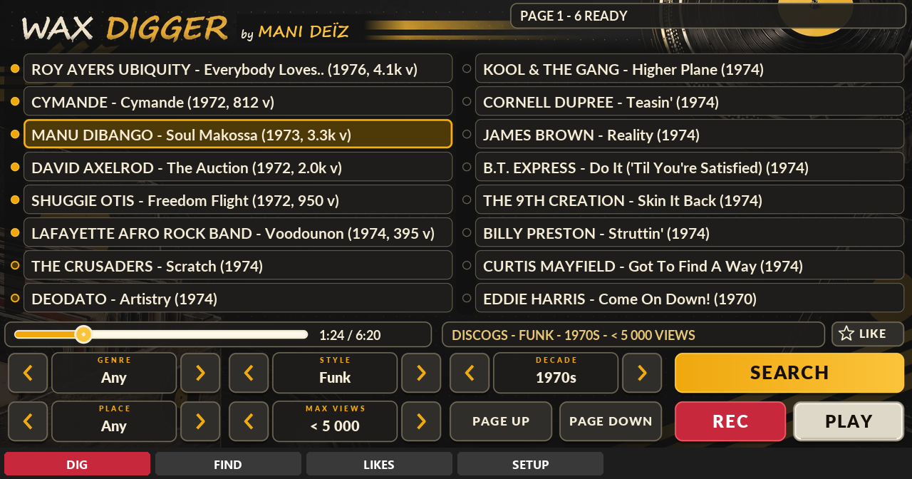
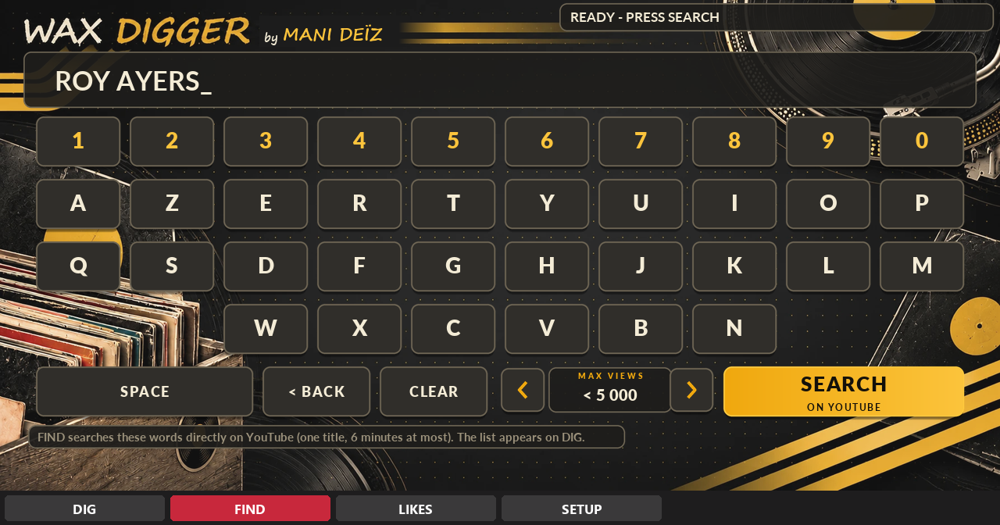
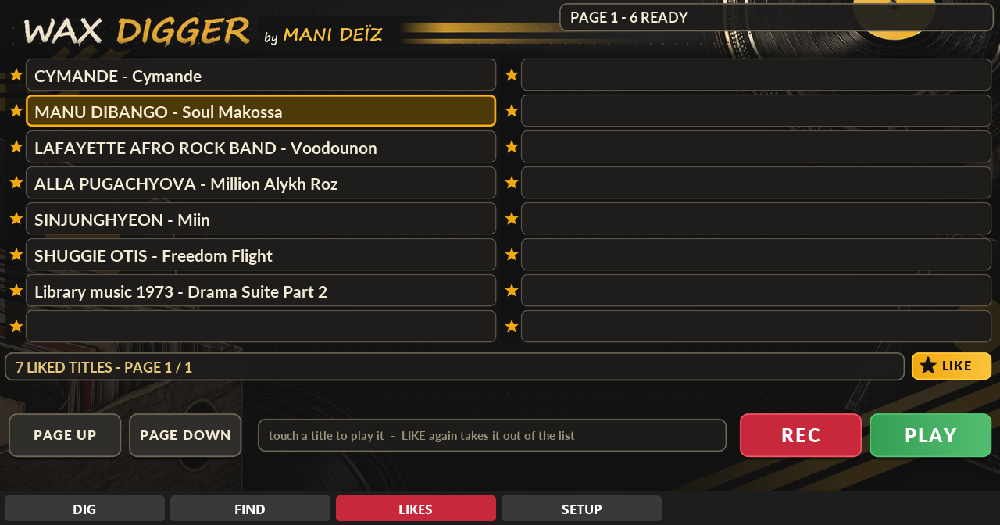
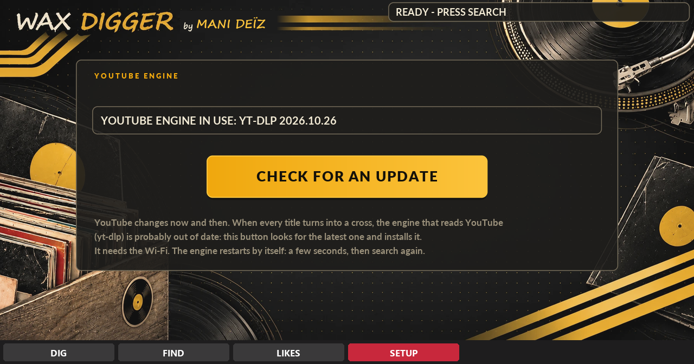

  

<h1 align="center">WAX DIGGER</h1>

  <b>A record digger inside your MPC.</b> 
  Search, tap a title, hear it at once, record the part you want. 
  by <b>MANI DEÏZ</b>

  
  
  
  

  <a href="download/WaxDigger.zip"><b>⬇&nbsp; DOWNLOAD</b></a>
  &nbsp;·&nbsp;
  <a href="INSTALL.md">Install guide</a>
  &nbsp;·&nbsp;
  <a href="#good-to-know">Good to know</a>

---

## What it does

Wax Digger turns the MPC into a crate of records with no bottom. It runs on the MPC itself, over its network
(Wi-Fi or Ethernet): no computer, no phone.

| | |
|---|---|
| **Instant** | Tap a title and it plays. The next ones load while you listen, so you can run down a page like in the MPC's own sample browser. |
| **Two ways to dig** | **DIG** by genre, style, decade and place. **FIND** by typing any words: an artist, a label, a drummer. |
| **The rare stuff** | A *Max views* filter keeps only the videos seen less than 500, 1 000, 5 000... times. That is where the unsampled records are. |
| **REC** | Record the part you want. It lands on your drive as a WAV named like the record, ready to chop. |
| **LIKES** | Star a title, find it again later in its own tab. |
| **Made for the hardware** | The data wheel walks through the titles, a push is play / pause. No knob to learn. |

## The screens

<table>
  <tr>
    <td align="center"> <b>FIND</b> type words, straight on YouTube</td>
    <td align="center"> <b>LIKES</b> the titles you starred</td>
    <td align="center"> <b>SETUP</b> keeps the YouTube reader up to date</td>
  </tr>
</table>

## Install

Easiest: with the **MANI DEÏZ HUB** plugin ([manideiz.github.io](https://manideiz.github.io)), touch *INSTALL* next to Wax Digger.
By hand:

1. Download **[WaxDigger.zip](download/WaxDigger.zip)** and unzip it.
2. Copy the folder found inside `VST2 Plugins` into the `VST2 Plugins` folder at the root of your SD card or USB drive
   (create that folder if it is not there). Do not rename it.
3. On the MPC: **Preferences → Enhancements (Beta)** → switch on *Enable Enhancements* and *External Plugin Support*.
4. Restart the MPC, connect it to the network (Wi-Fi or Ethernet), make a plugin track and pick **Wax Digger**.

The first start after each power-on takes up to a minute (*STARTING THE ENGINE*), then it says *READY - PRESS SEARCH*.
The full guide, with every button, is in **[INSTALL.md](INSTALL.md)**.

## Which MPCs

| MPC | |
|---|---|
| **Live III** | ✅ made and tested on it |
| **XL** | 🟡 should work (64-bit like the Live III), nobody has tried yet |
| **Live, Live II, One, One+, X, X SE, Key 37, Key 61, Force** | 🟡 32-bit engine included, not tried yet. The MPC One has no Wi-Fi: use an Ethernet cable |

## Good to know

- **YouTube does not like being asked too much.** Wax Digger only prepares the title you are on and the five after it.
  Race through hundreds of titles and the top line may say *YouTube refuses for now*: wait about 15 minutes.
- **Crosses on every title, for more than a day?** YouTube changed something. Open **SETUP**, press
  **CHECK FOR AN UPDATE**, search again.
- **A cross on one title** is normal: that video cannot be read.
- Titles longer than 6 minutes and *full album* videos are left out on purpose.
- **Something wrong?** Send the two small files `wax_log.txt` and `engine_log.txt` from the plugin folder on your drive,
  with one line saying what you did.

## Rights

Wax Digger is **© 2026 MANI DEÏZ, all rights reserved**. It is free to use: share the link, but please do not republish the zip
or reuse its code or graphics (see [LICENSE](LICENSE)). The separate programs it ships with (Python, FFmpeg, yt-dlp)
keep their own licences: [THIRD-PARTY-LICENCES.txt](THIRD-PARTY-LICENCES.txt).

Wax Digger is not made, endorsed or supported by Akai Professional, YouTube or Discogs.
What you record with it is yours to clear like any other sample.

MANI DEÏZ · beats, drums and tools

